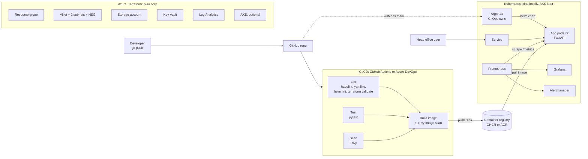

# Station Fuel Sales Platform

[](https://github.com/Ajoke29/station-fuel-sales-platform/actions/workflows/ci.yml)

A small, fully automated Cloud & DevOps project: a web app that shows daily fuel
sales for a chain of gas stations, plus everything needed to test it, package it,
deploy it to Kubernetes, describe its Azure home as code, and watch it once it runs.

> **Honest scope:** this is a portfolio project. All station names and numbers are
> made up. It runs on a laptop (Docker + a local Kubernetes cluster). The Azure part is
> written and validated, but it has **not** been applied. Nothing here runs in production.

---

## The story

Imagine a fuel retailer with 100+ gas and convenience stations across Newfoundland and
Labrador, Nova Scotia and PEI. Every station reports how many litres of regular,
premium and diesel it sold each day. Head office wants one simple page and an API to
see those numbers.

The IT team is small, so the way the app is **delivered** matters as much as the app:

- Every change is checked automatically (tests, linting, security scans) before it can ship.
- The app is packaged once (a container image) and runs the same everywhere.
- Kubernetes keeps it running and restarts it if it crashes.
- The cloud setup is written as code, so it can be reviewed, repeated and deleted.
- Dashboards and alerts tell the team when something is wrong, with a runbook saying what to do.

## Architecture



## What each folder does

| Folder | In plain words |
|---|---|
| `app/` | The website and API (Python, FastAPI) with its tests and Dockerfile. |
| `helm/station-fuel-sales/` | The "installation package" for Kubernetes. One chart, different settings for dev and prod. |
| `k8s/` | Settings to create a small Kubernetes cluster on your laptop with kind. |
| `argocd/` | Tells Argo CD to keep the cluster in sync with this Git repo (GitOps). |
| `infra/terraform/azure/` | The Azure network, storage, Key Vault and logging, written as code. See its [README](infra/terraform/azure/README.md). |
| `pipelines/` | The Azure DevOps pipeline. |
| `.github/workflows/` | The same pipeline for GitHub Actions (this is the one that runs on GitHub). |
| `monitoring/` | Prometheus settings, alert rules (with tests) and a Grafana dashboard. |
| `docs/runbooks/` | Step-by-step guides for when an alert fires. |
| `scripts/` | Small helper scripts. |

## The app

| URL | What it returns |
|---|---|
| `/` | A simple dashboard table: litres and revenue per station for the latest day |
| `/api/sales` | JSON sales records. Filters: `?province=NL`, `?station_id=NL-001`, `?date=2026-10-20` |
| `/api/stations` | The 12 fictional stations |
| `/healthz` | "Am I alive?" (used by Kubernetes liveness probe) |
| `/readyz` | "Am I ready for traffic?" (readiness probe) |
| `/metrics` | Numbers for Prometheus: request counts by route and status, latency, and a gauge of total litres sold |
| `/docs` | Auto-generated API documentation |

## Run it locally in 5 minutes

You need [Docker Desktop](https://www.docker.com/products/docker-desktop/). For the
Kubernetes part you also need `kind`, `kubectl` and `helm` (on a Mac: `brew install kind kubectl helm`).

**1. Just the container**

```bash
git clone https://github.com/Ajoke29/station-fuel-sales-platform.git
cd station-fuel-sales-platform
make docker-build
make docker-run          # open http://localhost:8080
make docker-stop
```

Without `make`: `docker build -t fuel-sales app && docker run --rm -p 8080:8000 fuel-sales`.

**2. On a local Kubernetes cluster**

```bash
make kind-up             # 1 control plane + 2 worker nodes, in Docker
make deploy-dev          # builds the image, loads it into kind, installs the Helm chart
kubectl -n fuel-sales-dev get pods
open http://localhost:8080
make kind-down           # delete the cluster when finished
```

**3. Run the tests and linters**

```bash
make venv                # one-time: Python virtual environment
make test                # pytest
make lint                # yamllint, hadolint, helm lint, terraform validate, alert-rule tests
```

## CI/CD flow

Every push and pull request runs the pipeline:

1. **Lint**: Dockerfile (hadolint), all YAML (yamllint), Helm chart for dev and prod
   (helm lint + template + kubeconform), Terraform (fmt + validate), alert rules (promtool).
2. **Test**: pytest unit tests for the data and every endpoint.
3. **Scan**: Trivy checks Python dependencies for known vulnerabilities and the repo for leaked secrets.
4. **Build**: builds the image, starts it and calls the health and API endpoints (smoke test),
   then Trivy scans the image. Fixable HIGH or CRITICAL issues fail the build.
5. **Push (main branch only)**: the image goes to GitHub Container Registry tagged with the
   commit SHA, so every running version can be traced back to its exact code.

The Azure DevOps version (`pipelines/azure-pipelines.yml`) has the same stages, pushes to an
Azure Container Registry through a service connection, and adds a **Deploy to dev** stage that
waits for an approver on the `fuel-sales-dev` environment before running `helm upgrade`.
The service connection names in that file are placeholders.

**GitOps option:** instead of the pipeline pushing to the cluster, Argo CD
(`argocd/application.yaml`) watches the `main` branch and applies the Helm chart itself. With
`selfHeal`, if someone changes the cluster by hand, Argo CD puts it back to what Git says.
(The first time CI pushes the image, GitHub makes the package private. Set it to public under
the repo's **Packages** settings so a cluster can pull it without a password.)

## Infrastructure as code (Azure)

`infra/terraform/azure/` describes a resource group, a virtual network with two subnets, a
network security group that only lets in web traffic (ports 80 and 443), a locked-down storage
account, a Key Vault, a Log Analytics workspace, and an optional AKS cluster (off by default).
It is split into small modules with described variables, outputs and tags.

CI only runs `terraform fmt` and `terraform validate`, which are free and need no Azure
account. How to plan, apply and destroy it cheaply is in the
[Terraform README](infra/terraform/azure/README.md).

## Monitoring

- The app exposes `/metrics`. In the prod values, a **ServiceMonitor** tells Prometheus to scrape it.
- `monitoring/kube-prometheus-stack-values.yaml` installs Prometheus, Grafana and Alertmanager on the local cluster.
- `monitoring/prometheus-rules.yaml` has alerts for **pods restarting / CrashLoopBackOff** and
  **more than 5% server errors**. `monitoring/tests/` proves the alerts fire when they should (`make monitoring-test`).
- `monitoring/grafana-dashboard.json` shows request rate, error rate, latency, pod restarts and litres sold by province.
- Each alert links to a runbook: [pod-crashloop](docs/runbooks/pod-crashloop.md), [high-error-rate](docs/runbooks/high-error-rate.md).

Try it: dev values set `CHAOS_ENABLED=true`, which turns on `/api/chaos/error` (always returns 500)
so you can watch the error-rate alert fire. It is off in prod.

```bash
helm repo add prometheus-community https://prometheus-community.github.io/helm-charts
helm upgrade --install kube-prometheus-stack prometheus-community/kube-prometheus-stack \
  -n monitoring --create-namespace -f monitoring/kube-prometheus-stack-values.yaml
kubectl apply -f monitoring/prometheus-rules.yaml
kubectl -n monitoring create configmap fuel-sales-dashboard \
  --from-file=monitoring/grafana-dashboard.json
kubectl -n monitoring label configmap fuel-sales-dashboard grafana_dashboard=1
helm upgrade station-fuel-sales helm/station-fuel-sales -n fuel-sales-dev \
  -f helm/station-fuel-sales/values-dev.yaml --set serviceMonitor.enabled=true
```

## Security choices

- **Container:** multi-stage build, slim base image with a pinned version, pip removed from the
  final image, runs as a non-root user (UID 10001), built-in `HEALTHCHECK`.
- **Kubernetes:** `runAsNonRoot`, read-only root filesystem (only `/tmp` is writable), all Linux
  capabilities dropped, no privilege escalation, seccomp `RuntimeDefault`, no service-account
  token mounted, CPU and memory limits.
- **Pipeline:** least-privilege `GITHUB_TOKEN` (package write only in the build job), images
  pushed only from `main`, tagged by commit SHA, vulnerability and secret scanning gates.
- **Azure:** TLS 1.2 minimum, no public blob access, no storage account keys (Entra ID only),
  firewalls default to deny, Key Vault with RBAC and purge protection, audit logs to Log
  Analytics, every resource tagged. No secrets are stored in this repo.
- Reviewed scanner exceptions are listed, with reasons, in `.trivyignore`.

## Cost

| Part | Cost |
|---|---|
| Docker, kind, Helm, Prometheus, Grafana on your laptop | Free |
| GitHub Actions + GitHub Container Registry for a public repo | Free |
| Terraform `fmt` / `validate` / `plan` | Free (no resources are created) |
| `terraform apply` on Azure | Small and billed by the hour; destroy the same day. AKS is off by default. |

## Roadmap

- [ ] Store the sales data in Azure Database for PostgreSQL instead of generating it
- [ ] A small upload endpoint so stations can post their daily totals
- [ ] Apply the Terraform for an hour on a free Azure account and record a walkthrough
- [ ] Run the app on AKS, pulling from Azure Container Registry with workload identity
- [ ] Secrets from Key Vault via the Secrets Store CSI driver
- [ ] Image signing (cosign) and an SBOM attached to each image
- [ ] NetworkPolicy and Kubernetes policy checks (Kyverno or Azure Policy)
- [ ] Promotion flow: dev to prod with Argo CD and pull-request approvals

## License

MIT, see [LICENSE](LICENSE).

---

Built by **Ajoke Soyombo** · [github.com/Ajoke29](https://github.com/Ajoke29)
